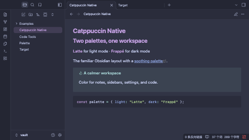

# Catppuccin Native

Catppuccin Native 是一款独立的 Obsidian 社区主题。浅色使用 Catppuccin Latte，深色使用 Catppuccin Frappé。配色覆盖正文、侧栏、设置和社区主题浏览器，字体、排版与交互沿用 Obsidian Default。

## 安装

1. 在仓库的配置目录下创建 `themes/Catppuccin Native/`。默认配置目录是仓库根目录下的 `.obsidian/`。
2. 将 [manifest.json](manifest.json) 和 [theme.css](theme.css) 放入该目录。
3. 在 Obsidian 的 **设置 → 外观 → 主题** 选择 **Catppuccin Native**。通过 **基础配色** 切换浅色、深色或跟随系统。

从旧名 Catppuccin Default 升级时，将新版的两个文件放进 `themes/Catppuccin Native/`，再在 **设置 → 外观 → 主题** 选择新名称。

## 可选配套插件

**Catppuccin Native Code Tools** 提供围栏代码块行号和彩虹括号。两个功能默认开启，可分别关闭。配套插件独立安装。

## 技术调研

逐项查看官方主题指南、CSS Variables 和 1.15.1 的内置 `app.css`，并用隔离仓库切换三种视图验证真实 DOM。当前发行版本以 Obsidian 的公开桌面更新日志为准。 [主题开发指南](https://docs.obsidian.md/Themes/App%20themes/Build%20a%20theme) · [CSS 颜色变量](https://docs.obsidian.md/Reference/CSS%20variables/Foundations/Colors) · [桌面更新日志](https://obsidian.md/changelog/)

| 视图 | 实机识别方式 | 颜色入口 |
| --- | --- | --- |
| Live Preview | `.markdown-source-view.mod-cm6.is-live-preview` 下的 `.cm-editor > .cm-scroller` | CodeMirror 的标题、链接、选区和代码变量。表格、数学和 Callout 还会渲染为行内组件。 |
| Source Mode | 同一个编辑器滚动容器，移除 `.is-live-preview` | 沿用同一套变量。标记、表格源码、任务状态和 TeX 由编辑器 token 暴露。 |
| Reading View | `.markdown-reading-view > .markdown-preview-view` | 原生渲染的 Markdown 元素。围栏内的语法类别来自 Prism。 |

正文颜色从主编辑工作区的 Markdown 叶片直接进入。背景在阅读容器和编辑滚动容器上着色，宿主的 `--background-primary` 继续提供其他主视图的默认底色。视图切换时，宿主会把另一个视图留在 DOM 中并隐藏，精确路径可以避免把隐藏编辑器误当作当前视图。两侧栏、标签栏、笔记顶部工具栏和状态栏分别用原生组件变量对接配色。内嵌设置和独立设置窗口都在 `.modal.mod-settings` 上读取局部色板和设置颜色变量。 [Obsidian 标签栏变量](https://docs.obsidian.md/Reference/CSS%20variables/Components/Tabs)

颜色优先对接宿主已有的变量，包括 `--h1-color` 至 `--h6-color`、`--text-selection`、`--caret-color`、`--code-*`、`--table-*`、`--callout-*` 和新版 Mermaid 的 `--mermaid-*`。删除线、行内代码独立前景和编辑源码的少数标记需要在笔记容器内补充选择器。源码中的 Callout 类型只是文本，CSS 可以识别 Callout token，却无法按其文本内容还原渲染后的语义类型。详细映射见 [COLOR-SPEC.md](COLOR-SPEC.md)。

色板直接来自 Catppuccin 官方数据。参考其用 Base 承载正文、Blue 表示链接、Rosewater 表示光标的惯例，由本项目独立实现 Obsidian 的颜色作用域和映射。 [官方色板](https://catppuccin.com/palette/) · [Catppuccin 设计规范](https://github.com/catppuccin/catppuccin/blob/main/docs/style-guide.md) · [Catppuccin for Obsidian](https://github.com/catppuccin/obsidian)

## 0.3.0 社区主题浏览器配色

在 macOS Obsidian 1.15.1 对照了内嵌和独立商店窗口。浅色和深色下的底面、筛选区、搜索框和卡片均读取各自的 Catppuccin 色板。卡片预览图的滤镜和透明度与原生一致。

## 0.2.1 设置配色

设置页在浅色与深色模式分别使用 Latte 与 Frappé。主面板、左侧导航、设置卡片、搜索框、按钮和选中项使用各自的颜色层级。在 macOS Obsidian 1.15.1 上对照了独立设置窗口和内嵌设置，核对配色、布局及分类切换。

## 0.2.0 工作区配色验收

在 macOS Obsidian 1.15.1 的临时仓库中，对照 0.1.0 检查了浅色、深色及三种笔记视图。左右侧栏与文件树、大纲、笔记顶部工具栏采用 Mantle，标签栏底面、左侧功能区、状态栏和侧栏搜索框采用 Crust。文件树的悬停与选中颜色各自生效。受测正文颜色、字体、间距和组件布局与 0.1.0 一致，内嵌设置的受测配色也一致。移动端抽屉尚未做真机验证。

## 0.1.0 正文配色验收

测试环境为 **macOS Obsidian 1.15.1**，使用独立的 Obsidian 配置和临时仓库。通过宿主主题加载器在 Default 与 Catppuccin Native 之间切换，分别测试两套基础配色和三种笔记视图。

| 验收项 | 结果 |
| --- | --- |
| Latte / Frappé | 两套色板的 52 个 HEX 与官方数据逐项相符。浅色正文底色为 `#eff1f5`，深色为 `#303446`。 |
| Live Preview / Reading View | H1–H6、文本强调、链接、标签、引用内嵌套强调、列表、复选框、Callout、表格、行内代码、围栏代码、数学公式和 Mermaid 使用相同的语义映射。对照了 MathJax 前景及 Mermaid 节点、连线和文字的实际计算颜色。 |
| Source Mode | 验证原始 Markdown 标记、任务状态、表头和分隔符、TeX、围栏代码及源码语法。JavaScript 样本对照了注释、关键字、字符串、数值、布尔值、函数和运算符。 |
| 编辑和选择 | 验证真实文本选区、光标、键盘输入及视图切换。Live Preview 和 Reading View 的任务勾选均能写回 Markdown，并可切回原状态。 |
| 当时的应用界面隔离 | 对照了边栏、标签、状态栏、工具栏、笔记内查找栏、HTML 右键菜单、快速切换弹窗和内嵌设置页面。0.2.0 扩展了工作区外框的配色范围。 |
| 排版和样式审查 | 样本的字体、字号、字重、行高、尺寸、间距、边框宽度、圆角、阴影、透明度、混合模式和过渡与默认样式的计算值一致。CSS 只有颜色声明和颜色相关变量，全部位于笔记作用域。运行时文件就是 manifest 和样式表。 |

Source Mode 使用 CodeMirror，Reading View 使用 Prism。两者有时会给同一段代码划分不同的 token。源码中的 Callout 和 Mermaid 分别按 Markdown 标记和围栏源码着色。渲染后的 Callout 类型或图表颜色在 Live Preview 和 Reading View 生效。较早的 Obsidian 版本、其他桌面平台及移动真机未纳入本次验收。

主题代码和 Catppuccin 色板数据采用 MIT 许可证。 [许可证](LICENSE)
